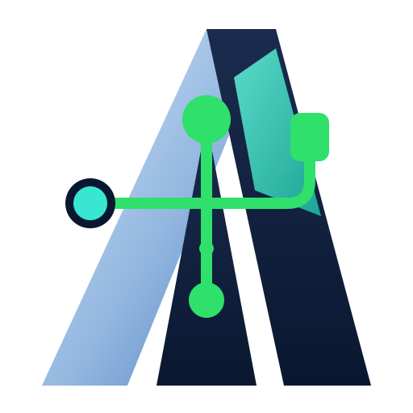
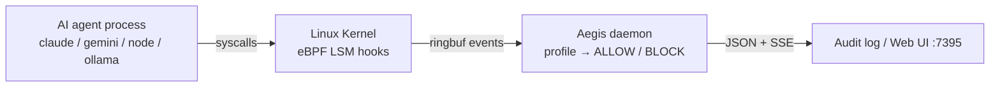

# Aegis

<p></p>

eBPF-based kernel-level behavioral tracing for AI agent workloads.

Aegis attaches to AI agent processes (Claude Code, Gemini CLI, Ollama, OpenCode, Cursor) and observes syscalls at the Linux kernel boundary via eBPF LSM hooks (`file_open`, `socket_connect`, `bprm_check`). It correlates LLM traffic with process execution, file access, network connections, and subprocess spawning without requiring SDK integration or proxy configuration.

## What Aegis does

- **Block unexpected file / network / exec** via kernel LSM before it completes
- **Track process trees** (claude → node → git → sh) by PID across forks/execs
- **Correlate prompts to effects** — see which command caused which file change or network call
- **Enforce per-framework profiles** (claude-code, gemini-cli, ollama, openclaw)
- **Audit every decision** — JSON line per ALLOW/BLOCK with reason, no SDK needed
- **Live web UI** at `:7395` — real-time BLOCK/ALLOW feed via SSE

## The problem it solves

AI agents (Claude Code, Gemini CLI, Ollama, Cursor) can execute arbitrary commands, open files, open network connections, and spawn child processes — often without the user knowing which prompt caused which effect. Existing observability requires SDK integration, proxy routing, or agent-native logging that can be disabled, incomplete, or unavailable for closed-source CLI tools.

Aegis solves this at the kernel boundary instead of inside the agent:

**Invisible child processes.** Agents spawn `node`, `python3`, `git`, `sh`, and other descendants that share process names with unrelated system processes. Without PID lineage tracking (`sched_process_exec`/`fork`/`exit` tracepoints), an enforcer either misses agent children or flags unrelated system daemons. Aegis follows the agent process tree so every child is correctly attributed.

**Opaque TLS traffic.** LLM traffic is encrypted end-to-end. Gateway/proxy tools only see it if you route through them; SDK-based tools only see it if the agent uses them. Aegis hooks `SSL_read`/`SSL_write` via uprobes and captures plaintext at the syscall boundary without proxy or SDK changes, even for statically-linked binaries (BoringSSL / OpenSSL).

**No per-framework policy.** A `claude-code` session, `gemini-cli` run, and `ollama` inference have different allowed paths, network targets, and command patterns. One static profile either over-permits (unsafe) or over-restricts (breaks functionality). Aegis loads YAML profiles per framework (`entry_comm`, allowed networks, denied paths, command allowlists) and evaluates against them inline.

**Audit without correlation.** When a run fails, stalls, or behaves unexpectedly, logs rarely link the failing prompt to the file that changed, the subprocess that spawned, or the network connection that exfiltrated data. Aegis correlates LLM traffic with system events through the process-tree + syscall sequence, producing a trace from prompt → tool call → subprocess → file/network effect.

**Reactive vs. preventive enforcement.** Most tools observe after the fact. Aegis uses eBPF LSM hooks (`file_open`, `socket_connect`, `bprm_check`) to evaluate against the loaded profile before the syscall completes, returning `ALLOW`/`BLOCK` at kernel level. Fail-closed (enforcement continues until daemon exits with pinned links) is documented; unpinned links after `kill -9` remain an open gap tracked in rollback docs.

**Use cases:**
- Secure CI/CD runners that run AI agent commands — enforce allowed paths and deny unexpected network to a CI node
- Developer workstation audit — trace which prompt caused a `git clone` or file write to `~/.ssh`
- Agent marketplace / sandbox testing — validate that an agent binary only touches allowed directories and connects only to expected endpoints
- Incident response — export `aegis-*.db` SQLite session with full syscall audit for forensic review
- Safety research — observe how agents behave with untrusted prompts (prompt injection detection) without relying on agent self-reporting

## How it works



- **Kernel layer** (`bpf/`): C programs observe `file_open`, `socket_connect`, and `bprm_check`; emit JSONL via ring buffer.
- **Process lineage** (`bpf/probe.c`): tracks agent process trees by PID through `sched_process_exec`, `sched_process_fork`, and `sched_process_exit` to attribute child processes (`node`, `sh`, `git`) correctly.
- **Profiles** (`profiles/`): YAML files defining allowed paths, networks, and commands per framework.
- **Detector** (`internal/detector`): evaluates kernel events against loaded profile.
- **Audit** (`internal/audit`): JSON line per decision (ALLOW/BLOCK) with reason.
- **Web UI** (`internal/ui`): real-time SSE feed with BLOCK/ALLOW badges.

## Quick start

```bash
# Build
make build

# Record a session
sudo ./aegis record -- claude

# Live top view
sudo ./aegis top --framework gemini-cli --ui

# List profiles
./aegis profile list

# Check policy
./aegis policy check ./profiles/ollama.yaml
```

## Requirements

- Linux 5.7+ with `CONFIG_BPF_LSM=y`
- Boot param: `lsm=bpf`
- `clang`, `llvm`, `bpftool`, `linux-headers`
- Root privileges to load eBPF
- Go 1.24+

## Technology stack

| Layer | Component |
|---|---|
| Kernel | `bpf/` — C + CO-RE + BTF |
| Daemon | Go (`cmd/`, `internal/`) |
| CLI | Cobra |
| Profiles | YAML (`profiles/`) |
| Loader | `github.com/cilium/ebpf` |
| UI / Audit | SSE + embedded HTML; JSONL |

## License

MIT. See `LICENSE`.
