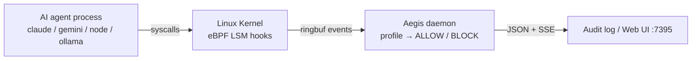

# Aegis

eBPF-based kernel-level behavioral tracing for AI agent workloads.

Aegis attaches to AI agent processes (Claude Code, Gemini CLI, Ollama, OpenCode, Cursor) and observes syscalls at the Linux kernel boundary via eBPF LSM hooks (`file_open`, `socket_connect`, `bprm_check`). It correlates LLM traffic with process execution, file access, network connections, and subprocess spawning without requiring SDK integration or proxy configuration.

## What Aegis does

- **Block unexpected file / network / exec** via kernel LSM before it completes
- **Track process trees** (claude → node → git → sh) by PID across forks/execs
- **Correlate prompts to effects** — see which command caused which file change or network call
- **Enforce per-framework profiles** (claude-code, gemini-cli, ollama, openclaw)
- **Audit every decision** — JSON line per ALLOW/BLOCK with reason, no SDK needed
- **Live web UI** at `:7395` — real-time BLOCK/ALLOW feed via SSE

## How it works



- **Kernel layer** (`bpf/`): C programs observe `file_open`, `socket_connect`, and `bprm_check`; emit JSONL via ring buffer.
- **Process lineage** (`bpf/probe.c`): tracks agent process trees by PID through `sched_process_exec`, `sched_process_fork`, and `sched_process_exit` to attribute child processes (`node`, `sh`, `git`) correctly.
- **Profiles** (`profiles/`): YAML files defining allowed paths, networks, and commands per framework.
- **Detector** (`internal/detector`): evaluates kernel events against loaded profile.
- **Audit** (`internal/audit`): JSON line per decision (ALLOW/BLOCK) with reason.
- **Web UI** (`internal/ui`): real-time SSE feed with BLOCK/ALLOW badges.

## Quick start

```bash
# Build
make build

# Record a session
sudo ./aegis record -- claude

# Live top view
sudo ./aegis top --framework gemini-cli --ui

# List profiles
./aegis profile list

# Check policy
./aegis policy check ./profiles/ollama.yaml
```

## Requirements

- Linux 5.7+ with `CONFIG_BPF_LSM=y`
- Boot param: `lsm=bpf`
- `clang`, `llvm`, `bpftool`, `linux-headers`
- Root privileges to load eBPF
- Go 1.24+

## Technology stack

| Layer | Component |
|---|---|
| Kernel | `bpf/` — C + CO-RE + BTF |
| Daemon | Go (`cmd/`, `internal/`) |
| CLI | Cobra |
| Profiles | YAML (`profiles/`) |
| Loader | `github.com/cilium/ebpf` |
| UI / Audit | SSE + embedded HTML; JSONL |

## License

MIT. See `LICENSE`.
